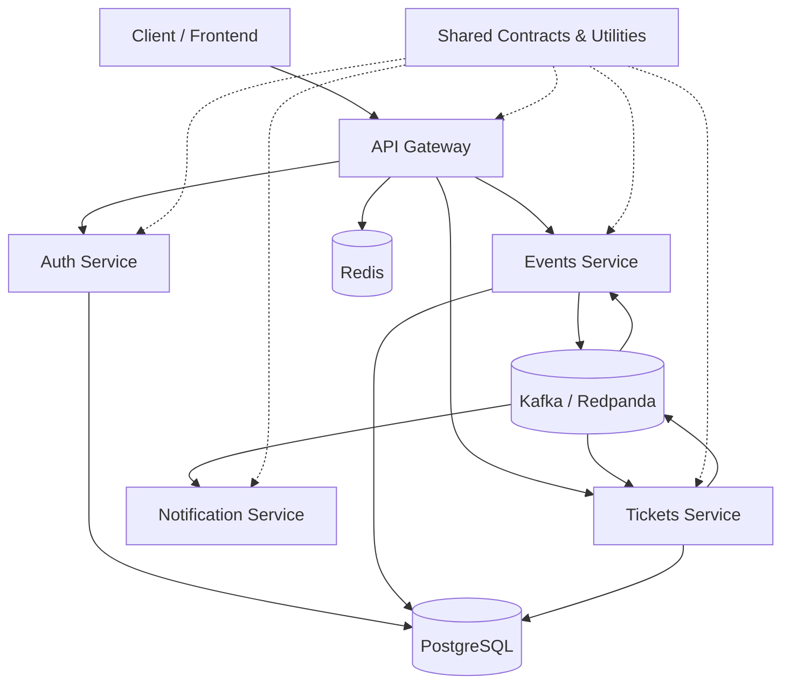

<div align="center">

# 🎟️ EventFlow App

### Event-Driven Ticketing Platform Built with NestJS Microservices

**A hands-on journey into scalable, distributed backend systems.**


**Status:** 🚧 In Development

</div>

---

## 📖 Overview

**EventFlow App** is an event-driven platform for managing events, ticketing, authentication, and notifications using independent NestJS microservices.

This project explores the **hard parts of modern backend engineering**: service boundaries, asynchronous communication, reliable APIs, shared contracts, and local infrastructure. Instead of placing everything in a monolith, EventFlow separates responsibilities into services that can evolve and scale independently.

> **Project scope:** This README describes the target architecture and planned functionality. Individual services and features may still be under development.

## ✨ Planned Features

| Component | Responsibilities |
| --- | --- |
| 🔐 **Auth Service** | Authentication, authorization, and identity workflows |
| 📅 **Events Service** | Event creation, updates, publishing, and discovery |
| 🎫 **Tickets Service** | Ticket inventory, reservations, and booking workflows |
| 🔔 **Notification Service** | Asynchronous notification processing |
| 🌐 **API Gateway** | Single API entry point, routing, global exception filters, and response interceptors |
| 📦 **Shared Library** | Reusable DTOs, interfaces, event contracts, and utilities shared across services |

### Architecture Goals

- **Loosely coupled services:** Clear ownership and independent business logic.
- **Event-driven workflows:** Kafka topics for asynchronous events and service-to-service reactions.
- **Type-safe persistence:** PostgreSQL and Drizzle ORM.
- **Consistent API behavior:** Standardized error handling and response formatting at the gateway.
- **Rate limiting:** Redis-backed limiting to help protect public endpoints.
- **Containerized development:** Docker Compose for reproducible local infrastructure.

## 🏗️ High-Level Architecture



**Example workflow (planned):** A customer requests a ticket through the API Gateway. The Tickets Service handles the request and publishes an event to Kafka. The Notification Service consumes the relevant event and processes the notification independently.

> The diagram is conceptual. Database ownership, routing, topics, and event contracts will be refined during implementation.

## 🛠️ Tech Stack

| Area | Technology |
| --- | --- |
| Backend framework | **NestJS** + **TypeScript** |
| Messaging | **Apache Kafka**; **Redpanda** for local development |
| Database | **PostgreSQL** |
| ORM | **Drizzle ORM** |
| Key-value store | **Redis** (rate limiting) |
| Infrastructure | **Docker** + **Docker Compose** |
| Package management | **pnpm** |
| Testing | **Jest** |
| Module format | **CommonJS (CJS)** |
| Optional frontend (Pro scope) | **Next.js 15**, **TanStack Query**, **Zustand**, **shadcn/ui** |

## 📁 Proposed Project Structure

```text
event-flow-app/
├── apps/
│   ├── api-gateway/
│   ├── auth-service/
│   ├── events-service/
│   ├── tickets-service/
│   └── notification-service/
├── packages/
│   └── shared/                # DTOs, interfaces, event contracts, utilities
├── infrastructure/           # Compose files and local infrastructure config
├── docs/                     # Architecture notes and API documentation
├── package.json
├── pnpm-workspace.yaml
└── README.md
```

*This is a proposed monorepo layout, not a claim about the repository's current files.*

## 🚀 Getting Started

### Prerequisites

Install the following on your machine:

- **Node.js** (an LTS version compatible with your NestJS dependencies)
- **pnpm**
- **Docker** and **Docker Compose**
- **Git**

### Local development plan

1. Clone the repository and open the project folder.
2. Install dependencies using `pnpm install` after the workspace is configured.
3. Configure environment variables for PostgreSQL, Redis, and the Kafka/Redpanda broker.
4. Start local infrastructure with the project's Docker Compose configuration once added.
5. Run the NestJS applications using the scripts defined in `package.json`.

> **Note:** Exact startup commands, ports, and `.env.example` values will be documented as the service implementations and Docker Compose setup are added.

## 🧪 Testing Strategy

The project aims to cover:

- **Unit tests** for service and application logic.
- **Integration tests** for persistence and message-driven integrations.
- **End-to-end tests** for API workflows across service boundaries.

**Testing framework:** Jest.

## 🗺️ Roadmap

- [ ] Initialize NestJS workspace and shared configuration
- [ ] Configure PostgreSQL and Drizzle ORM
- [ ] Set up Redpanda/Kafka and define topic contracts
- [ ] Build Auth Service
- [ ] Build Events Service
- [ ] Build Tickets Service
- [ ] Build Notification Service
- [ ] Implement API Gateway exception filters and interceptors
- [ ] Add shared internal package for DTOs, interfaces, and utilities
- [ ] Add Redis-backed rate limiting
- [ ] Containerize services with Docker Compose
- [ ] Add unit, integration, and E2E test coverage
- [ ] Document API endpoints and local deployment
- [ ] Explore optional Next.js frontend (Pro scope)

## 🎯 What You'll Learn

- Designing service boundaries in a distributed system
- Publishing and consuming Kafka events
- Working with type-safe database access through Drizzle ORM
- Building consistent and secure API gateway behavior
- Reusing contracts without tightly coupling service implementations
- Developing and testing microservices with containerized infrastructure

## 🤝 Contributing

Ideas, bug reports, and contributions are welcome. Please open an issue to discuss substantial changes before submitting a pull request.

---

<div align="center">

**Built to explore practical, scalable backend architecture.** 🚀

</div>
