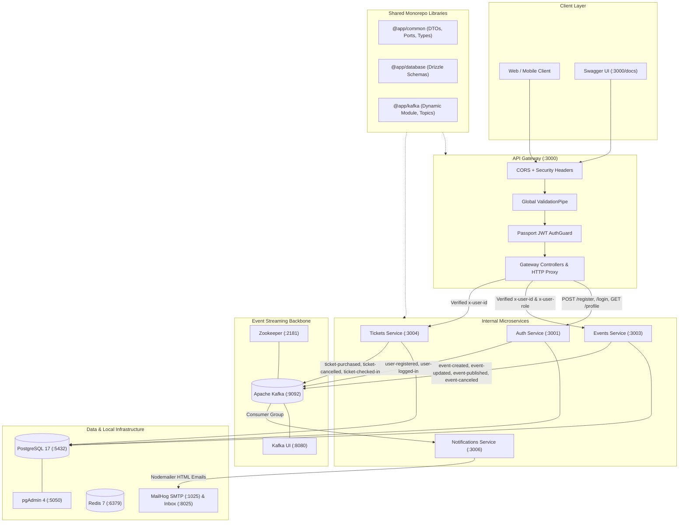
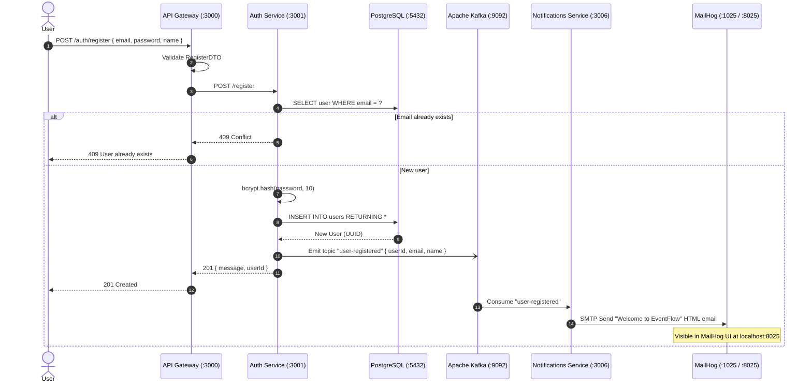
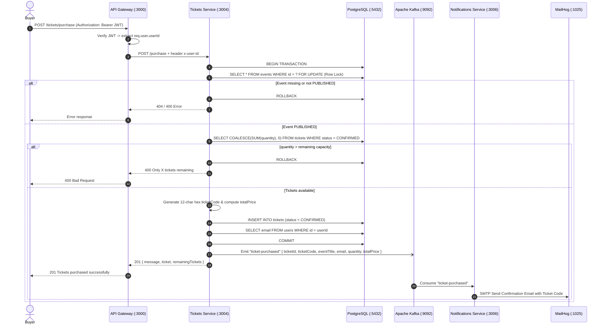
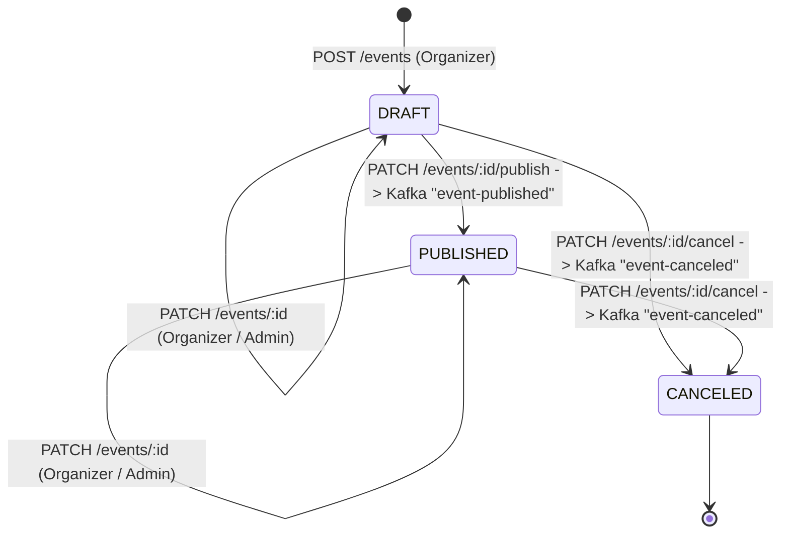
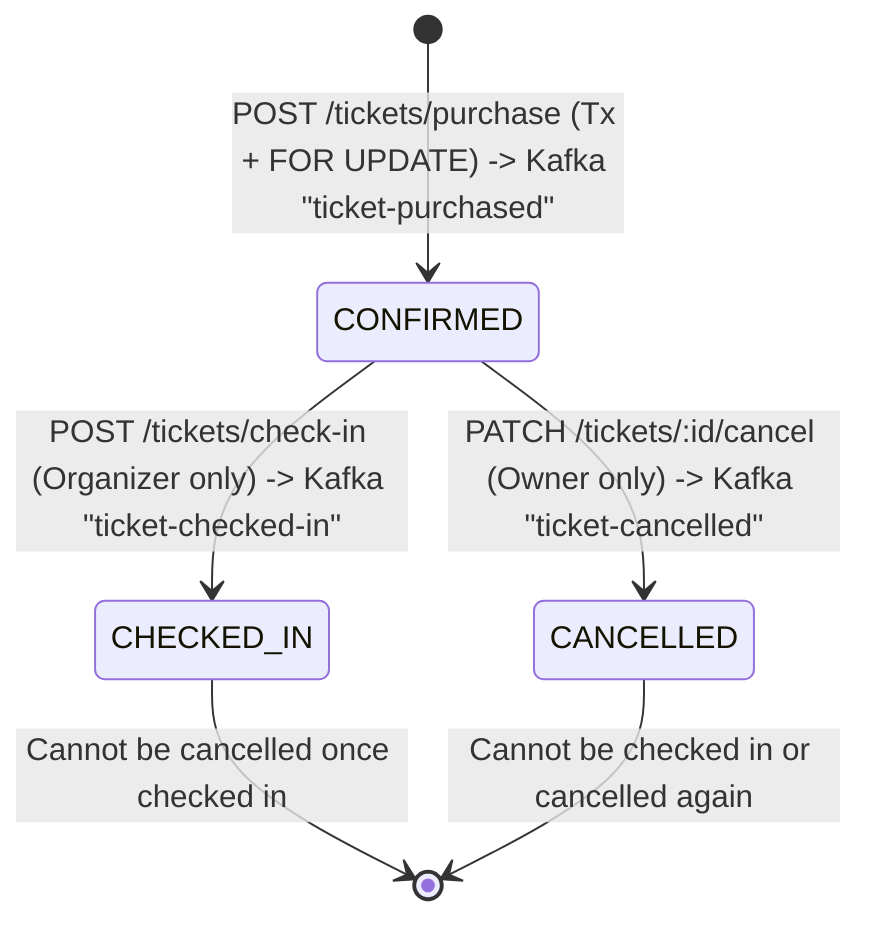
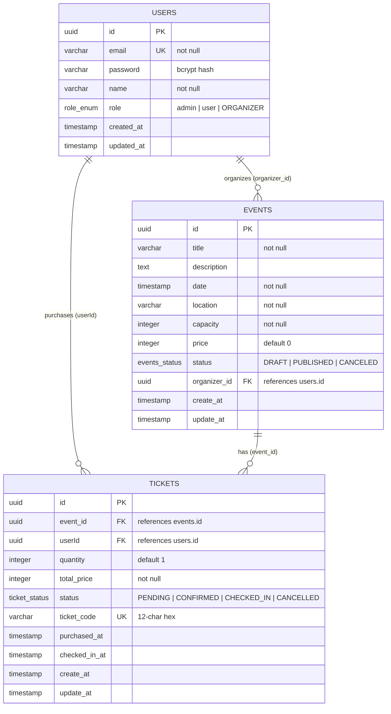
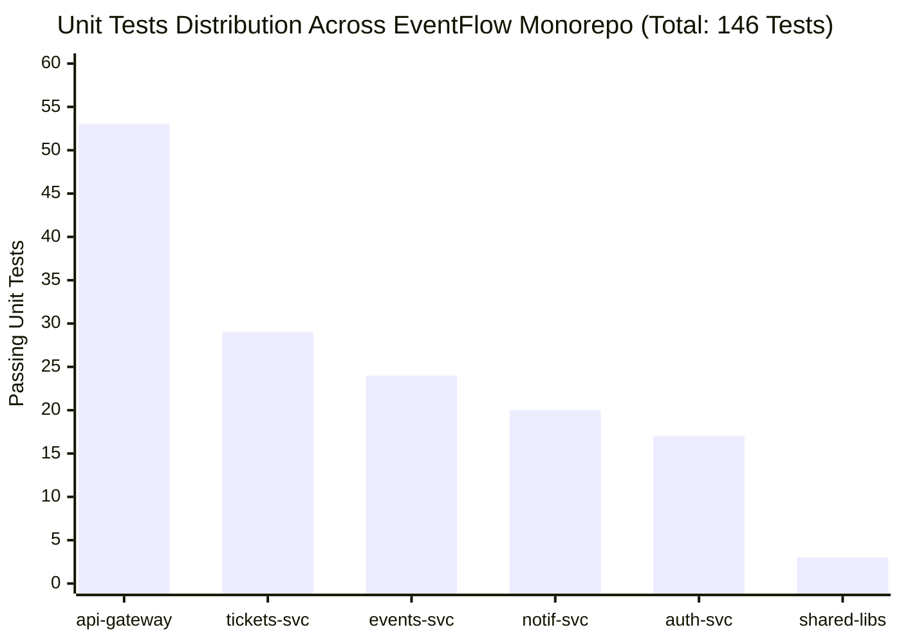

<div align="center">

# 🎟️ EventFlow App

### Event-Driven Ticketing Platform Built with NestJS Microservices

**A scalable, distributed backend built with NestJS, Apache Kafka, PostgreSQL, Drizzle ORM, Redis, Swagger, and Jest.**


**Status:** 🚀 Core Microservices, Event Streaming, Security Hardening & Full Unit Test Suite Complete

[Architecture](#️-system-architecture) •
[Backend Flows](#-how-the-backend-works-step-by-step) •
[Database ERD](#️-database-schema-erd) •
[Visual UI & Dashboards](#️-visual-ui--local-dashboards) •
[API Reference](#-api-endpoints-via-api-gateway) •
[Testing Chart](#-testing--coverage-chart) •
[Quick Start](#-getting-started)

</div>

---

## 📖 Overview

**EventFlow App** is an event-driven microservices platform for managing authentication, events, transactional ticket purchasing/check-in, and asynchronous email notifications.

Responsibilities are separated into 5 independent NestJS applications communicating **synchronously** through an **API Gateway** and **asynchronously** via **Apache Kafka**, backed by **PostgreSQL + Drizzle ORM**, **Redis**, **MailHog**, and 3 shared monorepo libraries (`@app/common`, `@app/database`, `@app/kafka`).

---

## 🏗️ System Architecture



---

## 🔄 How the Backend Works (Step-by-Step)

### 1. Request Security Pipeline (Inside API Gateway)

Every incoming HTTP request passes through a strict pipeline before touching any internal microservice:

```text
┌──────────────────────────────────────────────────────────────────────────────┐
│  Incoming HTTP Request  (e.g. POST /tickets/purchase)                        │
└───────────────────────────────────────┬──────────────────────────────────────┘
                                        ▼
┌──────────────────────────────────────────────────────────────────────────────┐
│  1. Security Headers & CORS           │ X-Frame-Options: DENY, nosniff, CORS │
│  2. Global ValidationPipe             │ whitelist + transform + forbidExtra  │
│  3. AuthGuard('jwt') + JwtStrategy    │ Verifies Bearer JWT signature & exp  │
│  4. Identity Extraction (req.user)    │ Reads trusted userId & role from JWT │
│  5. Internal HTTP Proxy (Axios)       │ Injects x-user-id / x-user-role      │
└───────────────────────────────────────┬──────────────────────────────────────┘
                                        ▼
┌──────────────────────────────────────────────────────────────────────────────┐
│  Internal Microservice (:3001 / :3003 / :3004)  ──►  PostgreSQL + Kafka      │
└──────────────────────────────────────────────────────────────────────────────┘
```

> Clients **cannot spoof** `x-user-id` or `x-user-role` headers at the gateway — protected routes strictly read `req.user` from the verified JWT.

---

### 2. User Registration & Welcome Email Flow



---

### 3. Transactional Ticket Purchase Flow (Race-Condition Safe)

When multiple users attempt to buy the last remaining tickets simultaneously, the Tickets Service uses a **PostgreSQL Transaction with Row-Level Locking (`SELECT ... FOR UPDATE`)** to guarantee zero overselling:



---

### 4. Domain Lifecycle State Machines

#### Event Lifecycle (`events.status`)


#### Ticket Lifecycle (`tickets.status`)


---

## 🗄️ Database Schema (ERD)

Managed with **Drizzle ORM** in [`libs/database/src/schema/`](libs/database/src/schema):



---

## 🖥️ Visual UI & Local Dashboards

When running locally, EventFlow provides **4 interactive web UIs** to test and observe every single layer in real time:

| Dashboard | Local URL | What You Can Inspect |
| --- | --- | --- |
| 📘 **API Gateway Swagger UI** | [http://localhost:3000/docs](http://localhost:3000/docs) | Interactive OpenAPI testing with **Authorize 🔒 (Bearer JWT)** across Auth, Events & Tickets |
| 📊 **Kafka UI** | [http://localhost:8080](http://localhost:8080) | Live Kafka brokers, topics (`user-registered`, `event-*`, `ticket-*`), JSON message payloads & consumer lag |
| 📬 **MailHog Web Inbox** | [http://localhost:8025](http://localhost:8025) | Rendered HTML welcome, ticket confirmation & cancellation emails sent via SMTP `:1025` |
| 🐘 **pgAdmin 4** | [http://localhost:5050](http://localhost:5050) | PostgreSQL 17 tables (`users`, `events`, `tickets`), constraints & SQL queries |

<details>
<summary><strong>🔍 Preview: What Happens Across the UIs During a Full Flow (Click to expand)</strong></summary>

```text
┌─────────────────────────────┐    ┌─────────────────────────────┐
│  1. Swagger UI (:3000/docs) │    │  2. Terminal (start:all)    │
│  ┌───────────────────────┐  │    │  [api-gateway        ] 3000 │
│  │ POST /auth/register   │  │───►│  [auth-service       ] 3001 │
│  │ POST /auth/login      │  │    │  [events-service     ] 3003 │
│  │ [🔒 Authorize: JWT]   │  │    │  [tickets-service    ] 3004 │
│  │ POST /events          │  │    │  [notifications-serv.] 3006 │
│  │ POST /tickets/purchase│  │    │  -> Received Kafka Event!   │
│  └───────────────────────┘  │    └──────────────┬──────────────┘
└─────────────────────────────┘                   │
                                                  ▼
┌─────────────────────────────┐    ┌─────────────────────────────┐
│  4. MailHog Inbox (:8025)   │    │  3. Kafka UI (:8080)        │
│  ┌───────────────────────┐  │    │  Topics:                    │
│  │ 🎉 Welcome to EventFlow│ ◄────│  • user-registered     [1]  │
│  │ 🎉 Ticket Confirmed!  │  │    │  • event-published     [1]  │
│  │   Code: A1B2C3D4E5F6  │  │    │  • ticket-purchased    [1]  │
│  │   Total: $100.00      │  │    │  • ticket-checked-in   [1]  │
│  └───────────────────────┘  │    └─────────────────────────────┘
└─────────────────────────────┘
```

</details>

---

## ✨ Services & Infrastructure Ports

| Service / Container | Port | Swagger / UI | Responsibilities |
| --- | --- | --- | --- |
| 🌐 **API Gateway** | `3000` | `http://localhost:3000/docs` | Single entry point, JWT auth, routing, CORS, security headers |
| 🔐 **Auth Service** | `3001` | `http://localhost:3001/docs` | Registration (`bcrypt`), login, JWT signing, user profile, Kafka producer |
| 📅 **Events Service** | `3003` | `http://localhost:3003/docs` | Event CRUD, organizer/admin RBAC, publish & cancel lifecycle |
| 🎫 **Tickets Service** | `3004` | `http://localhost:3004/docs` | Transactional ticket purchase, cancellation, ticket code check-in |
| 🔔 **Notifications Service** | `3006` | `http://localhost:3006/docs` | Kafka consumer & Nodemailer HTML email notifications |
| 🐘 **PostgreSQL 17** | `5432` | `http://localhost:5050` (pgAdmin) | Relational database (`eventflow_db`) |
| ⚡ **Redis 7** | `6379` | — | Caching & rate limiting store |
| 📨 **Apache Kafka** | `9092` | `http://localhost:8080` (Kafka UI) | Event streaming broker (with Zookeeper on `:2181`) |
| 📬 **MailHog** | `1025` | `http://localhost:8025` | Local SMTP server & inbox viewer |

---

## 🔗 API Endpoints (via API Gateway)

<details open>
<summary><strong>🔐 Auth (<code>/auth</code>)</strong></summary>

| Method | Endpoint | Auth | Description |
| --- | --- | --- | --- |
| `POST` | `/auth/register` | Public | Register a new user & emit `user-registered` |
| `POST` | `/auth/login` | Public | Authenticate user & return JWT token |
| `GET` | `/auth/profile` | Bearer JWT | Get authenticated user profile |

</details>

<details open>
<summary><strong>📅 Events (<code>/events</code>)</strong></summary>

| Method | Endpoint | Auth | Description |
| --- | --- | --- | --- |
| `GET` | `/events` | Public | List all `PUBLISHED` events |
| `GET` | `/events/organizer/:organizerId` | Public | List events by organizer ID |
| `GET` | `/events/:id` | Public | Get single event details |
| `POST` | `/events` | Bearer JWT | Create a new draft event |
| `GET` | `/events/my-events` | Bearer JWT | Get events created by the authenticated user |
| `PATCH` | `/events/:id` | Bearer JWT | Update event (organizer or `admin`) |
| `PATCH` | `/events/:id/publish` | Bearer JWT | Publish event & emit `event-published` |
| `PATCH` | `/events/:id/cancel` | Bearer JWT | Cancel event & emit `event-canceled` |

</details>

<details open>
<summary><strong>🎫 Tickets (<code>/tickets</code>)</strong></summary>

| Method | Endpoint | Auth | Description |
| --- | --- | --- | --- |
| `POST` | `/tickets/purchase` | Bearer JWT | Purchase tickets (atomic transaction + `FOR UPDATE` lock) |
| `GET` | `/tickets/my-tickets` | Bearer JWT | List authenticated user's tickets |
| `GET` | `/tickets/event/:eventId` | Bearer JWT | List all tickets for an event (organizer only) |
| `POST` | `/tickets/check-in` | Bearer JWT | Check in a ticket by `ticketCode` (organizer only) |
| `GET` | `/tickets/:id` | Bearer JWT | Get single ticket owned by the user |
| `PATCH` | `/tickets/:id/cancel` | Bearer JWT | Cancel ticket (`status = CANCELLED`) & emit `ticket-cancelled` |

</details>

<details>
<summary><strong>🔔 Notifications Service Kafka Consumers (<code>:3006</code>)</strong></summary>

| Pattern / Route | Topic / Endpoint | Action |
| --- | --- | --- |
| `GET` | `/health` | Returns service health status |
| `@EventPattern` | `user-registered` | Sends welcome HTML email |
| `@EventPattern` | `ticket-purchased` | Sends ticket confirmation email with code & formatted price |
| `@EventPattern` | `ticket-cancelled` | Sends ticket cancellation notice |
| `@EventPattern` | `event-canceled` | Sends event cancellation notice to organizer |

</details>

---

## 🔒 Security & Production Hardening

- **JWT Verification at the Gateway:** Protected Event & Ticket routes enforce `@UseGuards(AuthGuard('jwt'))` and extract `userId`/`role` exclusively from `req.user` (preventing client-side `x-user-id` / `x-user-role` spoofing).
- **Fail-Fast Production Secrets:** Startup throws immediately if `JWT_SECRET` is unset when `NODE_ENV=production`.
- **Gateway Hardening:** CORS via `CORS_ORIGIN`, `x-powered-by` disabled, security response headers (`X-Content-Type-Options`, `X-Frame-Options`, `Referrer-Policy`, `X-XSS-Protection`), and Swagger disabled by default in `NODE_ENV=production`.
- **Concurrency Safety:** Ticket purchases run inside a PostgreSQL transaction with `.for('update')` row locking to prevent overselling.
- **Strict Input Validation:** Global `ValidationPipe` (`whitelist`, `transform`, `forbidNonWhitelisted`).
- **Environment-Driven Service Discovery:** Gateway uses `AUTH_SERVICE_URL`, `EVENTS_SERVICE_URL`, and `TICKETS_SERVICE_URL`.

---

## 🧪 Testing & Coverage Chart

The monorepo contains **21 unit test suites** with **146 passing unit tests** covering controllers, services, JWT strategies, Drizzle DB interactions, Kafka event emissions, Nodemailer email delivery, RBAC checks, and error propagation.



| Package | Test Suites | Passing Tests | What Is Covered |
| --- | :---: | :---: | --- |
| `apps/api-gateway` | 8 | **53** | App, Auth/Events/Tickets controllers & HTTP proxies, JWT strategy, 503 & downstream error handling |
| `apps/tickets-service` | 2 | **29** | Transactional purchase, capacity limits, check-in, cancel guards, organizer RBAC, Kafka emits |
| `apps/events-service` | 2 | **24** | Event CRUD, publish/cancel lifecycle, organizer & lowercase `admin` RBAC, Kafka emits |
| `apps/notifications-service` | 3 | **20** | Kafka `@EventPattern` handlers, HTML escaping, missing-email guards, Nodemailer MailHog & TLS config |
| `apps/auth-service` | 3 | **17** | Register (`bcrypt`), conflict check, login, JWT signing, profile lookup, Kafka init & fallback |
| `libs/*` (`common`, `database`, `kafka`) | 3 | **3** | Shared library service initialization |
| **Total** | **21** | **146** | **100% passing + 0 TypeScript errors (`tsc -b --noEmit`)** |

```bash
# Run all unit tests
pnpm test

# Run tests with coverage report
pnpm test:cov

# Type-check all apps, libraries, and *.spec.ts files
npx tsc -b --noEmit
```

---

## 📁 Project Structure

```text
eventsflow-app/
├── apps/
│   ├── api-gateway/              # Port 3000 — HTTP gateway, JWT auth, Swagger, routing
│   ├── auth-service/             # Port 3001 — Users, bcrypt, JWT signing, Kafka producer
│   ├── events-service/           # Port 3003 — Events CRUD & lifecycle, Kafka producer
│   ├── tickets-service/          # Port 3004 — Transactional ticketing & check-in, Kafka producer
│   └── notifications-service/    # Port 3006 — Kafka consumer & Nodemailer email service
├── libs/
│   ├── common/                   # Shared DTOs, response interfaces, service port constants
│   ├── database/                 # Drizzle PostgreSQL client & schemas (users, events, tickets)
│   └── kafka/                    # Dynamic KafkaModule & topic constants
├── scripts/
│   └── start-all.js              # Cross-platform multi-service runner (dev / build / prod)
├── docker-compose.yml            # PostgreSQL 17, pgAdmin, Redis, Zookeeper, Kafka, Kafka UI, MailHog
├── drizzle.config.ts             # Drizzle ORM PostgreSQL config
├── jest.config.ts                # Jest config with tsconfig path mapping
├── tsconfig.json                 # Solution-style TS config
├── tsconfig.spec.json            # Dedicated TS config for *.spec.ts & test files
├── .env.example                  # Environment variable keys template
└── package.json
```

---

## 🚀 Getting Started

### Prerequisites

- **Node.js** (v20+ LTS)
- **pnpm**
- **Docker** & **Docker Compose**

### 1. Install Dependencies
```bash
pnpm install
```

### 2. Configure Environment Variables
```bash
cp .env.example .env
# Fill in DATABASE_URL, JWT_SECRET, KAFKA_BROKER=localhost:9092, SMTP_HOST=localhost, SMTP_PORT=1025, etc.
```

### 3. Start Local Infrastructure (PostgreSQL, pgAdmin, Redis, Kafka, Kafka UI, MailHog)
```bash
pnpm run docker:up
```

### 4. Push Database Schema
```bash
pnpm run db:push
```

### 5. Run All Microservices
Start all 5 apps in parallel with colored logs in a single command:
```bash
pnpm run start:all
```

Or run them individually:
```bash
pnpm run start:gateway
pnpm run start:auth
pnpm run start:events
pnpm run start:tickets
pnpm run start:notifications
```

Build & start all apps in production mode:
```bash
pnpm run build:all
pnpm run start:all:prod
```

---

## 🗺️ Roadmap

- [x] Initialize NestJS monorepo workspace and shared libraries (`@app/common`, `@app/database`, `@app/kafka`)
- [x] Configure PostgreSQL 17 and Drizzle ORM schemas (`users`, `events`, `tickets`)
- [x] Set up Docker Compose stack (PostgreSQL, pgAdmin, Redis, Zookeeper, Kafka, Kafka UI, MailHog)
- [x] Build Auth Service (register, login, profile, JWT, bcrypt, Kafka events)
- [x] Build Events Service (CRUD, publish/cancel lifecycle, organizer & admin RBAC)
- [x] Build Tickets Service (transactional purchase with `FOR UPDATE` row lock, cancellation, check-in)
- [x] Build Notifications Service (Kafka consumers + HTML email delivery via Nodemailer/MailHog)
- [x] Build API Gateway with JWT guards, Swagger OpenAPI + Bearer Auth, CORS, and security headers
- [x] Add single-command multi-service runner (`pnpm run start:all`, `build:all`, `start:all:prod`)
- [x] Add comprehensive unit test coverage across all services & libraries (21 suites / 146 tests)
- [x] Configure dedicated `tsconfig.spec.json` for IDE & CLI test type-checking
- [ ] Wire Redis-backed rate limiting (`@nestjs/throttler`) in API Gateway
- [ ] Add production `Dockerfile`s and `docker-compose.prod.yml`
- [ ] Add end-to-end (E2E) integration tests against live Postgres & Kafka
- [ ] Explore optional Next.js frontend (Pro scope)

---

## 🤝 Contributing

Ideas, bug reports, and contributions are welcome. Please open an issue to discuss substantial changes before submitting a pull request.

---

<div align="center">

**Built to explore practical, scalable, event-driven backend architecture.** 🚀

</div>
